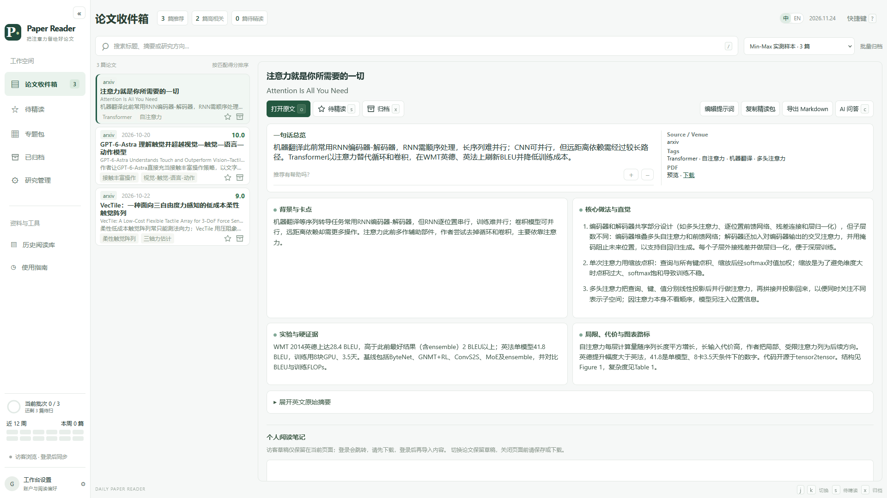

# Daily Paper Reader

**English** · [简体中文](README.zh-CN.md) · [Open the reader](https://mux2001.github.io/daily-paper-reader/)

An inbox triage workspace for daily papers. Spend three minutes scanning a batch, queue papers worth reading, and archive the rest.



## Why this fork

Thanks to `ziwenhahaha/daily-paper-reader` for the retrieval pipeline and original reader. This fork builds a daily workflow around four changes.

- **A keyboard-first inbox.** Navigate a compact queue beside a 2×2 reading grid. A progress ring tracks the current batch and a 12-week heatmap shows reading activity.
- **Cached Min-Max previews.** See where earlier methods get stuck, how the new method works, what the authors measured and which figures to inspect. The daily job extracts these facts in advance, so opening a paper makes no model request. The original abstract stays available.
- **Two ways to go deeper.** Press `c` to ask a question beside the paper. Copy a Deep-Read Pack into an external model for a longer discussion, or export a Markdown note to disk or Obsidian.
- **Two language controls.** Switch the interface and default prompts with **中 / EN**. Set `SUMMARY_LANG` for newly generated summaries. Existing papers keep their cached text.

## How it works

1. **GitHub Actions** retrieves papers for the subscriptions in `config.yaml`, reranks and scores candidates, then writes the selected papers and cached previews to `docs/data/daily/`.
2. **GitHub Pages** serves the compiled reader and those JSON files. The daily schedule is 18:37 UTC. A successful daily run with a reader batch calls the publication workflow.
3. **The browser** reads the static feed, syncs personal state and notes to Supabase under the signed-in account, and contacts the configured model directly when you use Ask AI.

## Five-minute quick start

1. Fork **MuX2001/daily-paper-reader** with **Copy the dev branch only** checked, then confirm your fork’s default branch is `dev`. Edit `subscriptions.intent_profiles` in [config.yaml](config.yaml) to match your research interests.
2. Create a Supabase project for **reader state**. In its SQL Editor, run [create_paper_states_schema.sql](sql/create_paper_states_schema.sql) in full. It creates the notes and feedback fields, grants signed-in access, and installs owner-only row-level security (RLS). Enable email/password sign-in. The public paper sources in `config.yaml` are ready to query. You can skip building a paper catalog. The other [SQL scripts](sql/) are for catalog or statistics administration.
3. In your fork, open **Settings → Secrets and variables → Actions**. For the standard daily setup add two **repository secrets**: `DEEPSEEK_API_KEY` with your API key, and `DEEPSEEK_MODEL` with an available model ID (for example `deepseek-flash`). The daily job reads this model from **Secrets**. No repository variable or personal GitHub token is required for this setup.
4. Enable workflows in **Actions**. In **Settings → Actions → General → Workflow permissions**, allow read and write. In **Settings → Pages**, choose **Deploy from a branch → dev → /(root)**. Click **Save**. The release workflow commits the compiled homepage, assets and feed to `dev`, requests a Pages build and verifies the published commit.
5. Open **Actions → daily-paper-reader → Run workflow** on `dev`. Leave the action on `daily` and the content mode on `triage`. When publication finishes, open your fork’s Pages homepage. In **Workspace settings → Account & sync**, enter and verify your project URL and publishable/anon key. Register or sign in with an email account for that project, confirm the email if prompted, then star a paper and refresh to check sync.

**Optional integrations.** Configure Ask AI for in-page chat, or copy a Deep-Read Pack without a model key. For Obsidian, choose an export mode and vault. To recover older reading records, open **Data & maintenance**, preview the browser records or JSON backup, then import into the signed-in account.

**Local run.** From the repository root, use Python 3.11 with the project dependencies from [requirements.txt](requirements.txt) and [requirements-reader.txt](requirements-reader.txt) in an activated environment. Copy [.env.example](.env.example) to `.env`, fill in the daily model key and ID, then run:

```bash
PYTHONPATH=src python src/main.py --content-mode triage --export-triage
```

To run the reader against the published feed, use Node.js 24 in the repository root:

```bash
npm ci
DPR_READER_DATA_DIR="$PWD/docs/data" npm run dev -- --port 5173 --strictPort
```

Open the [local reader](http://127.0.0.1:5173/). Existing batches are available without running Python.

## Secrets and keys reference

### 1. GitHub Actions Secrets & Variables

The two entries in step 3 cover the standard daily path. Other entries below apply to the named feature. GitHub supplies the workflow token used to commit and publish.

| Name | Store | Requirement and default |
|---|---|---|
| `DEEPSEEK_API_KEY` | Secret | Key for daily scoring and default triage. |
| `DEEPSEEK_MODEL` | Secret | Set to `deepseek-flash` for daily runs. Triage requires this secret or the `TRIAGE_MODEL` variable. |
| `DEEPSEEK_BASE_URL` | Variable / Secret | Daily endpoint override via Secret. Deep read checks the Variable first. Default: `https://api.deepseek.com`. |
| `SUMMARY_LANG` | Variable | Language of generated previews. Default `zh`. Use `en` for English. |

Some scoring code still uses the legacy alias `deepseek-v4-flash`. Use `deepseek-flash` for new configurations. [DeepSeek model reference](https://api-docs.deepseek.com/quick_start/pricing/)

<details><summary>Feedback and notifications</summary>

| Name | Store | Requirement and default |
|---|---|---|
| `DPR_STATE_SUPABASE_URL`, `DPR_STATE_SERVICE_KEY`, `DPR_FEEDBACK_USER_ID` | Secret | For feedback-based ranking, set all three: state project URL, server credential and Auth user UUID. Unset disables personalization from feedback. |
| `DPR_NOTIFY_FEISHU_WEBHOOK` | Secret | Feishu digest webhook. Unset skips notifications. |

</details>

<details><summary>Retrieval, reranking and triage</summary>

| Name | Store | Requirement and default |
|---|---|---|
| `DPR_EMBED_API_URL`, `DPR_EMBED_API_KEY` | Secret | Embedding endpoint and credential. Hosted endpoint defaults to https://zwwen.online/embed with its built-in client fallback. |
| `RERANK_PROFILE` | Secret | Reranker preset. A workflow input takes precedence over this secret. Default: `public-zwwen-rerank`. |
| `RERANK_PROVIDER`, `RERANK_MODEL`, `RERANK_API_BASE_URL`, `RERANK_API_KEY` | Secret | Provider, model, endpoint and key overrides. Defaults depend on the selected preset and client. |
| `PUBLIC_RERANK_API_BASE_URL`, `PUBLIC_RERANK_API_KEY` | Secret | Public reranker endpoint and key. Defaults to https://zwwen.online/rerank and the public client fallback. |
| `SILICONFLOW_RERANK_URL`, `SILICONFLOW_API_KEY` | Secret | SiliconFlow preset only. Default endpoint is https://api.siliconflow.cn/v1/rerank. Provide a provider key when using this service. |
| `SILICONFLOW_RERANK_MIN_INTERVAL_SECONDS` | Secret | Minimum interval between SiliconFlow requests, 8 seconds in Actions. |
| `TRIAGE_API_KEY`, `TRIAGE_MODEL`, `TRIAGE_BASE_URL` | Secret / Variable / Variable | Separate triage key, model and endpoint. Each inherits its DEEPSEEK counterpart, then the official endpoint if no URL is set. |

</details>

<details><summary>Optional cloud deep reads</summary>

These settings apply to the optional GitHub Actions deep-read job. Copy Deep-Read Pack copies the prompt and paper context without credentials. The cloud job also accepts `DEEPSEEK_MODEL` and `DEEPSEEK_BASE_URL` as repository variables.

| Name | Store | Requirement and default |
|---|---|---|
| `DEEP_READ_API_KEY` | Secret | Dedicated deep-read key. Falls back to the daily key on the same endpoint. A different provider needs its own key. |
| `DEEP_READ_MODEL`, `DEEP_READ_BASE_URL` | Variable / Secret | Dedicated model and endpoint. Variable precedes Secret. Inherit daily settings if unset. With no model, the official endpoint defaults to deepseek-flash; a custom endpoint requires a model ID. |
| `OBSIDIAN_NOTES_REPO` | Variable | Private vault repository (owner/repo). Unset skips server-side note sync. |
| `OBSIDIAN_NOTES_BRANCH`, `OBSIDIAN_NOTES_FOLDER` | Variable | Branch and folder in the vault repository. Defaults are `main` and `Inbox`, respectively. |
| `OBSIDIAN_NOTES_TOKEN` | Secret | Vault repository token with Contents write permission, required only for server-side note sync. |

</details>

<details><summary>Catalog maintenance and legacy settings</summary>

| Name | Store | Requirement and default |
|---|---|---|
| `SUPABASE_URL`, `SUPABASE_ANON_KEY` | Secret | Read-only retrieval catalog overrides for starter packs and topic research. Defaults come from the configured catalog. |
| `SUPABASE_SERVICE_KEY` | Secret | Catalog maintenance only. Supply the target catalog’s server key. Maintenance jobs have fixed targets and repository allowlists. |
| `OPENREVIEW_USERNAME`, `OPENREVIEW_PASSWORD` | Secret | Optional OpenReview login for conference ingestion. Leave both unset for public access. |
| `SUMMARY_API_KEY`, `SUMMARY_BASE_URL`, `SUMMARY_MODEL` | Secret | Overrides for the legacy summary path. Each falls back to the corresponding daily setting. |
| `LLM_PRIMARY_BASE_URL` | Secret | Legacy environment binding, unset by default. The summary step sets it from its resolved endpoint. |

</details>


### 2. Supabase frontend configuration

| Account & sync field | What to enter |
|---|---|
| Supabase URL | The URL of the project where you installed `paper_states`. Save and verify the connection. |
| Publishable / anon key | The public client key from that same project. RLS checks the signed-in user’s ID on reads and writes. |
| Email and password | Register or sign in to the reader’s Supabase Auth project. Use the same account on each device to sync stars, archive state, feedback and saved notes. |

> **Security:** Never paste a Supabase service-role key into the website or commit it to Git. The credential sometimes called `SUPABASE_SERVICE_ROLE_KEY` is privileged. This repository reads `SUPABASE_SERVICE_KEY` for catalog maintenance and `DPR_STATE_SERVICE_KEY` for optional server-side feedback. Only a publishable/anon key belongs in the browser.

### 3. Browser workspace settings

| Section | Inputs and scope |
|---|---|
| Web AI chat | Select DeepSeek, OpenAI, OpenRouter or Custom. Enter the base URL, model ID and API key, test the connection and save. |
| Research tasks | Enter your fork as `owner/repo`, branch `dev` and a GitHub token to dispatch workflows or edit subscriptions. |
| Export & Obsidian | Choose Markdown, Obsidian or both. Set the vault, inbox folder (blank for vault root) and filename format. Browser export needs no vault repository token. |
| Data & maintenance | Preview legacy records from this browser or a JSON file, select the old user if needed, then import. This tab also clears saved keys and offers a separate local test connection. |

> **Token scope:** Use a **fine-grained PAT** restricted to your fork, with **Actions: Read and write** for dispatch. Grant **Contents: Read and write** only if you also save subscription edits. Avoid a classic PAT with broad `repo` scope. The chat key and GitHub token stay in memory by default. “Remember” saves the selected credential to this browser’s localStorage. Use it only on a personal device.

## Keyboard shortcuts and branch policy

| Key | In the inbox |
|---|---|
| `j` / `k` | Next / previous paper |
| `s` | Add to or remove from the reading queue |
| `x` | Archive or restore the paper |
| `o` | Open the original paper |
| `c` | Toggle the side-by-side AI chat |
| `/` | Focus search |
| `Esc` | Close the active panel or dialog |
| `?` | Show keyboard help |

Target **dev** for pull requests, development, scheduled jobs and Pages releases. **main** is reserved for fast-forward mirroring of upstream `ziwenhahaha/daily-paper-reader`. Maintainers can cherry-pick selected upstream fixes onto `dev`. See the [branch maintenance rules](AGENTS.md#分支维护).
