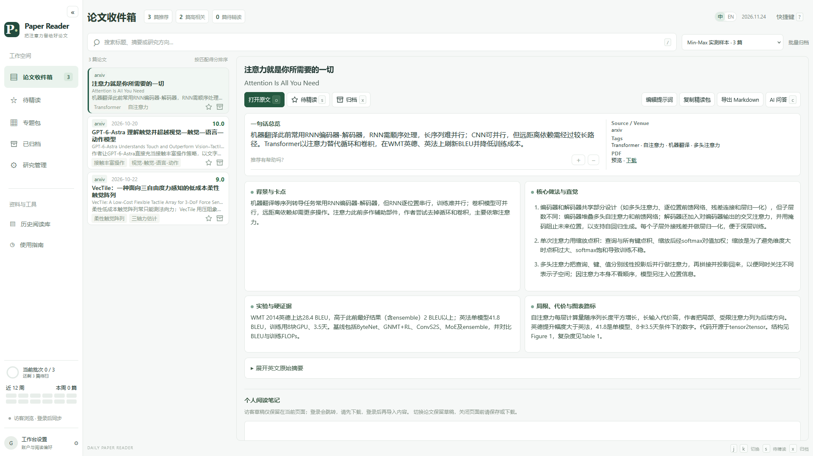

# Daily Paper Reader

[English](README.md) · **简体中文** · [打开阅读器](https://mux2001.github.io/daily-paper-reader/)

每天用三分钟筛论文的收件箱。扫一遍当日推荐，想细读的按一下收藏，其余归档。



## 为什么做这个 Fork

感谢 `ziwenhahaha/daily-paper-reader` 提供论文检索流水线和初代阅读器。这一版围绕每天筛论文的过程做了四处调整。

- **在收件箱筛论文。** 中栏看标题和一句话简介，选中论文后在右栏看速览与原始摘要。可以全程用键盘操作，进度环显示本批进度，热力图展示最近 12 周的阅读情况。
- **速览提前算好。** 有完整速览的论文按背景、做法、实验结果与局限展开。打开论文就能看，同时保留原始摘要供核对。
- **给值得追的论文留出口。** 按 `c` 在正文旁追问；也可以复制精读包，交给自己常用的强模型。想留底时直接下载 Markdown 或发到 Obsidian。
- **界面和摘要分别选语言。** 顶部 **中 / EN** 切换界面和默认提示词。在工作台设置里选择「新生成速览语言」，历史摘要保留生成时的文字。

## 系统如何协作

1. **GitHub Actions** 读取 `config.yaml` 的订阅方向，召回、重排、打分，再把入选论文与速览写入 `docs/data/daily/`。
2. **GitHub Pages** 提供编译后的阅读器和日报 JSON。北京时间 00:00–05:59 内首个到达的定时检查启动当夜日报，每晚最多一次；日报成功生成批次后自动调用发布流程。
3. **浏览器** 读取静态日报，把阅读状态和笔记同步到当前账户的 Supabase。只有使用网页问答时，浏览器才向配置的聊天模型发送提问和论文上下文。

## 五分钟快速部署

1. Fork **MuX2001/daily-paper-reader**，保留勾选 **Copy the dev branch only**，并确认 Fork 的默认分支为 `dev`。发布后可在侧栏「研究管理」编辑自己的研究方向。
2. 新建用于**阅读状态**的 Supabase 项目，在 SQL Editor 完整执行 [create_paper_states_schema.sql](sql/create_paper_states_schema.sql)。这一个脚本包含笔记、反馈字段、登录用户授权和按用户隔离的 RLS 策略。启用邮箱密码登录。公共论文检索源已在 `config.yaml` 中配好，无需自建论文库；[其余 SQL](sql/) 用于维护论文库或站点统计。
3. 创建限当前 Fork 的 Fine-grained PAT，将 **Actions、Contents、Secrets** 三项设为 **Read and write**。发布后在阅读器里用它连接仓库。
4. 在 **Actions** 页启用工作流。在 **Settings → Actions → General → Workflow permissions** 开启读写权限；在 **Settings → Pages** 选择 **Deploy from a branch → dev → /(root)**，点 **Save**。发布工作流会把编译后的首页、资源和日报数据提交到 `dev`，再请求 Pages 构建并核对发布的提交。
5. 从 dev 手动运行一次 **Publish compiled reader to existing Pages**。打开站点 → **工作台设置 → 日报模型与研究管理连接**，保存仓库、dev 和 PAT，选模型、填日报密钥，点「保存流水线配置到 GitHub」，再点「立即运行一次今日推荐」。需要云同步时，在「账户与同步」验证 Supabase URL 和公开密钥并登录。

**运行和查看推荐。** 在侧栏打开「研究管理」，点「读取仓库配置」。在「日常管理 → 每日推荐」选择研究方向和检索窗口，点「准备运行任务」，核对后确认提交。「最近运行」可刷新并打开 GitHub 运行记录。宽屏下它在右侧，窄屏下向下滚动即可看到。

**更新网页。** 推送阅读器源码后，要立即上线就从 `dev` 再运行一次 **Publish compiled reader to existing Pages**；定时日报成功生成批次也会触发发布。

**可选集成。** 需要边读边问时再配置网页 AI；复制精读包无需模型密钥。使用 Obsidian 时选择导出方式和 Vault。迁移旧记录可在「数据与维护」读取当前浏览器记录或 JSON 备份，预览后导入已登录账户。

**本地运行。** 在已激活的 Python 3.11 项目环境中安装 [requirements.txt](requirements.txt) 和 [requirements-reader.txt](requirements-reader.txt) 的依赖。在仓库根目录将 [.env.example](.env.example) 复制为 `.env`，填写日报密钥 `DEEPSEEK_API_KEY`，模型和速览语言在 [config.yaml](config.yaml) 的 `pipeline` 中设置，然后执行：

```bash
PYTHONPATH=src python src/main.py --content-mode triage --export-triage
```

用 Node.js 24 在仓库根目录启动前端，直接读取随仓库发布的日报：

```bash
npm ci
DPR_READER_DATA_DIR="$PWD/docs/data" npm run dev -- --port 5173 --strictPort
```

打开 [本地阅读器](http://127.0.0.1:5173/)。浏览现有日报无需先运行 Python。

## 密钥与配置速查

### 1. GitHub Actions Secrets 与 Variables

工作台将模型、端点、语言和重排选项写入 dev/config.yaml，新填的密钥用仓库公钥在浏览器加密后直传 Actions Secrets。留空沿用已有密钥；公共重排免填 Key。

| 配置名 | 存放位置 | 用途与默认行为 |
|---|---|---|
| `DEEPSEEK_API_KEY` | Secret | 标准日报必填，供评分和默认速览共用。 |
| `DEEPSEEK_MODEL` | Secret | YAML 未指定模型时使用的历史兼容项。 |
| `DEEPSEEK_BASE_URL` | Variable / Secret | 日报优先使用 YAML 中的端点，缺省时读取环境配置；精读优先读取同名 Variable。默认值：`https://api.deepseek.com`。 |
| `SUMMARY_LANG` | Variable | 仅在 YAML 未指定 `pipeline.summary_lang` 时生效，可填 `zh` 或 `en`。 |

部分旧评分代码仍使用兼容别名 `deepseek-v4-flash`。新配置统一填 `deepseek-flash`。[DeepSeek 官方模型目录](https://api-docs.deepseek.com/quick_start/pricing/)

<details><summary>反馈调权与通知</summary>

| 配置名 | 存放位置 | 用途与默认行为 |
|---|---|---|
| `DPR_STATE_SUPABASE_URL`, `DPR_STATE_SERVICE_KEY`, `DPR_FEEDBACK_USER_ID` | Secret | 反馈调权需同时提供状态库 URL、服务端密钥和 Auth 用户 UUID；留空关闭反馈调权。 |
| `DPR_NOTIFY_FEISHU_WEBHOOK` | Secret | 飞书日报 webhook，留空不推送。 |

</details>

<details><summary>检索、重排与速览</summary>

| 配置名 | 存放位置 | 用途与默认行为 |
|---|---|---|
| `DPR_EMBED_API_URL`, `DPR_EMBED_API_KEY` | Secret | 向量服务地址与密钥，默认使用 https://zwwen.online/embed 和客户端的公共服务回退配置。 |
| `RERANK_PROFILE` | Secret | 重排预设，依次使用手动运行输入、YAML 预设、环境配置。默认值：`public-zwwen-rerank`。 |
| `RERANK_PROVIDER`, `RERANK_MODEL`, `RERANK_API_BASE_URL`, `RERANK_API_KEY` | Secret | 重排服务商、模型、端点与密钥，留空按所选预设和客户端解析。 |
| `PUBLIC_RERANK_API_BASE_URL`, `PUBLIC_RERANK_API_KEY` | Secret | 公共重排端点和密钥，默认使用 https://zwwen.online/rerank 和公共客户端的回退配置。 |
| `SILICONFLOW_RERANK_URL`, `SILICONFLOW_API_KEY` | Secret | 仅 SiliconFlow 重排需要，默认端点 https://api.siliconflow.cn/v1/rerank，使用时提供服务商密钥。 |
| `SILICONFLOW_RERANK_MIN_INTERVAL_SECONDS` | Secret | SiliconFlow 请求最小间隔，Actions 默认 8 秒。 |
| `DAILY_READER_MODEL` | Variable | YAML 未指定模型时使用的历史兼容项。 |
| `TRIAGE_API_KEY`, `TRIAGE_MODEL`, `TRIAGE_BASE_URL` | Secret / Variable / Variable | 默认速览沿用日报配置。启用独立速览后可单设密钥；模型和端点优先读取 YAML 对应字段。 |

</details>

<details><summary>可选云端精读任务</summary>

仅手动运行 GitHub Actions 精读时使用。网页「复制精读包」只复制提示词和论文上下文，无需配置这些密钥。精读也可从同名 Variables 读取 `DEEPSEEK_MODEL` 和 `DEEPSEEK_BASE_URL`。

| 配置名 | 存放位置 | 用途与默认行为 |
|---|---|---|
| `DEEP_READ_API_KEY` | Secret | 精读专用密钥，同端点可复用日报密钥；换服务商需提供对应密钥。 |
| `DEEP_READ_MODEL`, `DEEP_READ_BASE_URL` | Variable / Secret | 精读模型、端点，Variable 优先于 Secret。留空沿用日报配置，官方端点缺模型时选 deepseek-flash，自定义端点必须配置模型。 |
| `OBSIDIAN_NOTES_REPO` | Variable | 私有笔记仓库（owner/repo），留空跳过精读任务的云端同步。 |
| `OBSIDIAN_NOTES_BRANCH`, `OBSIDIAN_NOTES_FOLDER` | Variable | 独立笔记仓库的分支与目录，默认分别为 `main` 和 `Inbox`。 |
| `OBSIDIAN_NOTES_TOKEN` | Secret | 仅云端同步精读笔记时需要，授权目标笔记仓库 Contents 写权限。 |

</details>

<details><summary>论文库维护与旧版兼容</summary>

| 配置名 | 存放位置 | 用途与默认行为 |
|---|---|---|
| `SUPABASE_URL`, `SUPABASE_ANON_KEY` | Secret | 入门包和专题检索可覆盖论文库 URL 与只读公钥，默认取论文源配置。 |
| `SUPABASE_SERVICE_KEY` | Secret | 仅维护论文库时需要目标库的服务端密钥。维护工作流限定目标项目及可运行仓库。 |
| `OPENREVIEW_USERNAME`, `OPENREVIEW_PASSWORD` | Secret | 抓取会议论文时可提供 OpenReview 账号密码，默认匿名访问。 |
| `SUMMARY_API_KEY`, `SUMMARY_BASE_URL`, `SUMMARY_MODEL` | Secret | 旧版摘要链路的密钥、端点和模型，默认沿用日报配置。 |
| `LLM_PRIMARY_BASE_URL` | Secret | 历史兼容项，默认留空；摘要步骤会按解析后的端点设置它。 |

</details>


### 2. Supabase 前端连接

| 账户与同步字段 | 填写内容 |
|---|---|
| Supabase URL | 填创建了 `paper_states` 的项目地址，然后点「保存并验证连接」。 |
| Publishable / anon key | 填同一项目的公开客户端密钥。每次读写都由 RLS 核对登录用户 ID。 |
| 邮箱与密码 | 在阅读器所连的 Supabase Auth 项目注册或登录。在不同设备使用同一账户，即可同步收藏、归档、反馈和已保存的笔记。 |

> **安全提醒：** 严禁把 Supabase service-role 密钥填进网页或提交到仓库。常见名称 `SUPABASE_SERVICE_ROLE_KEY` 指的是高权限凭据；本项目实际用 `SUPABASE_SERVICE_KEY` 维护论文库，用 `DPR_STATE_SERVICE_KEY` 在服务端读取个人反馈。前端只填 publishable/anon key。

### 3. 浏览器工作台设置

| 分组 | 配置和用途 |
|---|---|
| 账户与同步 | 连接阅读状态库，登录、同步或退出当前账户。 |
| 网页 AI 聊天 | 可选择 DeepSeek Flash、DeepSeek Pro、OpenAI、OpenRouter 或自定义预设，填写端点、模型 ID、API Key，测试后保存。 |
| 日报模型与研究管理连接 | 连接自己的 Fork，保存日报模型和语言，按需单设速览模型。重排可选公共服务、SiliconFlow 或自定义端点。 |
| 导出与 Obsidian | 选择下载 Markdown、发送到 Obsidian 或同时显示两个入口。可设置 Vault、收件箱目录（留空为根目录）和文件命名格式。网页导出无需笔记仓库 Token。 |
| 数据与维护 | 从本浏览器或 JSON 备份读取旧记录，按需选择旧用户名，预览后导入。这里也可以清除已保存的密钥，或连接独立的本地测试库。 |

> 配置流水线时，给单仓库 Fine-grained PAT 授予 **Contents、Secrets、Actions 读写权限**。阅读器即可提交 YAML、写入加密密钥和触发任务，无需去仓库后台逐个添加 Secrets。

## 快捷键与分支约定

| 按键 | 在收件箱中的操作 |
|---|---|
| `j` / `k` | 下一篇 / 上一篇 |
| `s` | 加入或移出待精读 |
| `x` | 归档或恢复当前论文 |
| `o` | 打开论文原文 |
| `c` | 展开或收起并排 AI 问答 |
| `/` | 聚焦搜索框 |
| `Esc` | 关闭当前面板或弹窗 |
| `?` | 查看快捷键说明 |

开发、定时任务、Pages 发布和 PR 均使用 **dev**。**main** 仅用于快进镜像上游 `ziwenhahaha/daily-paper-reader`。需要某项上游修复时，由维护者挑选到 `dev`。详见[分支维护守则](AGENTS.md#分支维护)。
